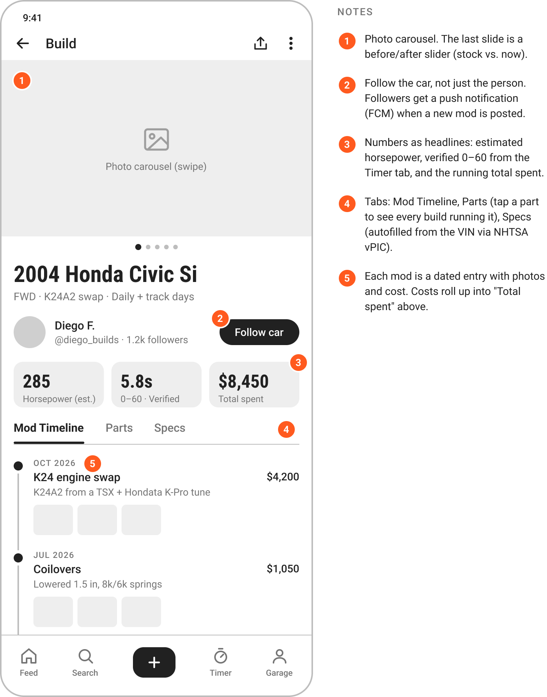

# Milestone 1 - Moddit (Unit 7)

## Table of Contents

1. [Overview](#Overview)
1. [Product Spec](#Product-Spec)
1. [Wireframes](#Wireframes)

## Overview

### Description

Moddit is an app that allows users to post their cars and the modifications they have done to them. Moddit allows users to create account to keep track of not only their cars, but also be able to have a list of modifications they wish to make to their cars and plan for their future modifications. Users are able to comment under other users' posts to ask for help, suggest any advice, or simply write a comment about the car. Users can be able to personalize their profile and add their own touch. 

## App Evaluation

[Evaluation of your app across the following attributes]
## 1 *"Moddit"* 
### - This app is a social media app where users can post their cars and any modifications that the user has done to the car

### App Evaluation
- **Category:** Social networking / Automotive
- **Mobile:** Users can take pictures of their cars and modifications with their phone and upload them directly. Notifications can alert users to comments and likes on their posts.
- **Story:** Car enthusiasts can document their builds, share the modifications they have made, and find inspiration from other users' cars.
- **Market:** The intended audience is car enthusiasts, especially people who modify their cars or want ideas for future builds. A community focused on a single car model could be a useful starting audience.
- **Habit:** Users could browse builds regularly, interact with other owners, and post updates whenever they make a modification. Browsing may happen more often than posting because modifications take time and money.
- **Scope:** A first version could include accounts, car profiles, photo posts with modification descriptions, a feed, likes, and comments. Parts marketplaces, direct messaging, and detailed build cost tracking could be added later.

## Product Spec

### 1. User Features (Required and Optional)

**Required Features**

1. As a user I want to be able to post my car and list the modifications I've done to it.
2. As a user I want to see other user's cars and their modifications
3. As a user I want to be able to see the price of modifications to plan for my own mods.

**Optional Features**

1. As a user, I want to be able to see nearby shops. 
2. As a user I want to be able to follow people.
3. As a user I want to be able to message people directly. 

### 2. Screen Archetypes

- Login Screen
  - Users can create an account or login to their already existing accounts.
- Home Feed
  - Users can brose through other users post of their cars and modifications.
  - User can like, select the post for more details and comment on those posts.
- Post Details
  - Users can view the post photos and additional descriptions.
  - Users can read comments from other users and comment themselves.
- Create Post
  - Users can select one of their cars, take or upload photos, also list modifications and their details.
  - Users can publish the post to appear on other users' feeds.
- User Profile (Their Garage)
  - Users can view their profile and their cars.
  - User can modify profile, description, or select one of their cars and manage it.
  - Users can log out from their own profile.
- Car Details
  - Users can view a car's year, make, model, photos, or modification posts.
    
### 3. Navigation

**Tab Navigation** (Tab to Screen)

* Home -> Home Feed
* Create -> Create Post
* Profile -> User Profile / My Garage

  
**Flow Navigation** (Screen to Screen)

- Login / Sign Up
  - Switch between login and create account.
  - Successful login / creation of account -> Home Feed
- Home Feed
  - Select a post -> Post Details
  - Select a user's name/avatar -> User's Profile 
- Post Details
  - Select the author -> User Profile.
  - Select the car -> Car details
  - Back -> Previous screen
- Create Post
  - If the user garage is empty, then Add new Car -> add / If car exists, Edit Car. Saving returns to create post with the new car selected.
  - Publish successful -> Home Feed, shows the new post.
  - Cancel -> Home Feed.
- User Profile / Garage
  - Select a car -> Car Details.
  - Select a post -> Post Details.
  - Add -> Add a car from you from your own garage. Edit Car -> Edit existing car.
- Car Details
  - Select a modification post -> Post Details.
  - Edit your own car -> Add / Edit Car.
  - Back -> Previous screen.
## Wireframes

 

 

### [BONUS] Digital Wireframes & Mockups

 
