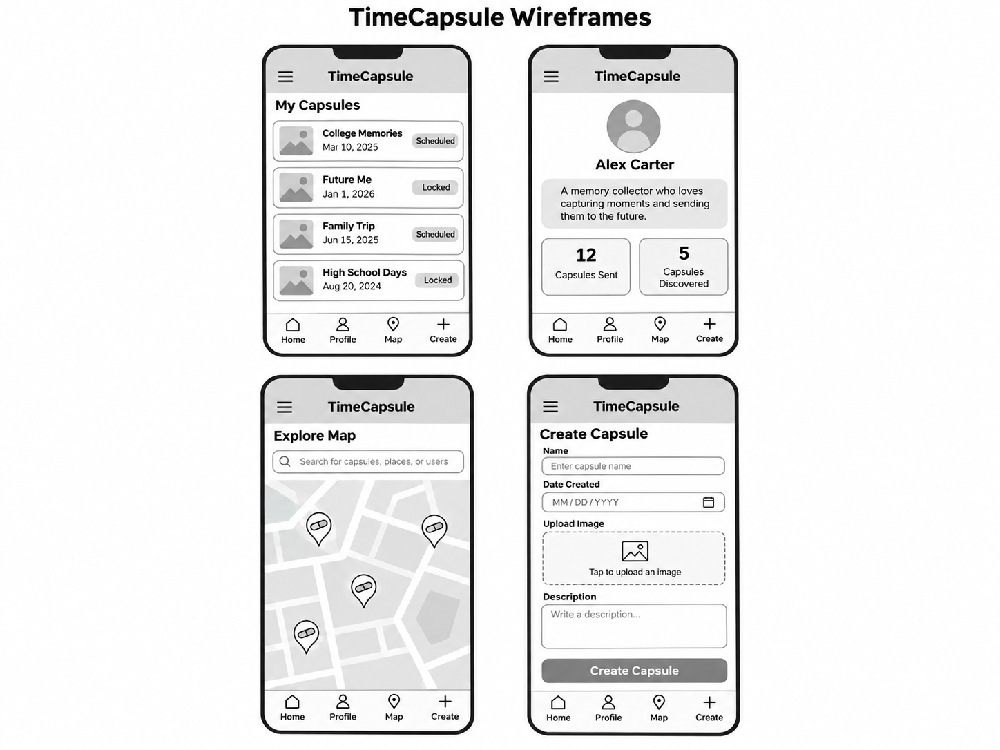

# Milestone 1 - Capsule (Unit 7)

## Table of Contents

1. [Overview](#overview)
2. [App Evaluation](#app-evaluation)
3. [Product Spec](#product-spec)
4. [Wireframes](#wireframes)

## Overview

### Description

Capsule is a location-based time capsule app where users can leave memories for others to discover. Users create digital capsules containing a title, message, and photos, place them at their current location, and choose a future unlock date. Other users can discover capsules on a map, visit their locations, and open them once the unlock date has passed and they are nearby.

Users can personalize their profiles, track the capsules they have created and found, save capsules they want to visit, and revisit memories from capsules they have already opened.

The features below describe the planned app experience.

## App Evaluation

- **Category:** Social / Exploration / Digital memories.
- **Mobile:** The phone's location helps users place and find capsules, while the camera and photo library let them add photos to their memories. Opening a capsule for the first time requires visiting its location after its unlock date.
- **Story:** Users can preserve a moment in a meaningful place and let someone discover it in the future. Exploring nearby capsules connects digital memories to real-world locations.
- **Market:** The intended audience is people who enjoy exploring, sharing memories, or discovering stories about places. A campus community could provide a starting audience, with students leaving capsules around shared locations.
- **Habit:** Users could check for nearby capsules while exploring, return when saved capsules unlock, and create capsules for memorable moments. New capsules and upcoming unlock dates give users reasons to return.
- **Scope:** The first version focuses on accounts, profiles, capsule creation with messages and photos, unlock dates, map discovery, location-based opening, saved capsules, and discovery history. Notifications and additional map filters could be added later.

## Product Spec

### 1. User Features (Required and Optional)

These features build on the project's [user stories](userstories.md).

**Required Features**

1. [ ] As a user, I want to create an account and log in so that my profile and capsules are saved between visits.
2. [ x ] As a user, I want to customize my profile image and description and see how many capsules I've found and created.
3. [ ] As a user, I want to create a time capsule at my current location.
4. [ x ] As a user, I want to add a title, message, and photos to my capsule so that I can preserve a memory for someone to discover.
5. [ x ] As a user, I want to choose a future unlock date so that my capsule's contents stay hidden until that date.
6. [ ] As a user, I want to view nearby capsules on a map so that I can discover capsules around me.
7. [ ] As a user, I want to see a capsule's title, distance from me, and unlock date so that I can plan which capsules to visit.
8. [ ] As a user, I want to open an unlocked capsule when I am near its location so that discovering it involves visiting the place where it was left.
9. [ ] As a user, I want to see how much time remains before a locked capsule opens so that I know when to return.
10. [ ] As a user, I want to save capsules I want to visit so that I can find them again later.
11. [ ] As a user, I want to view my opened capsules so that I can revisit their messages and photos.
12. [ ] As a user, I want to view and manage the capsules I've created so that I can track their locations and unlock dates.
13. [ ] As a user, I want to delete a capsule I've created if I no longer want to share it.

**Optional Features**

1. [ ] As a user, I want to receive a notification when a saved capsule unlocks so that I know when I can visit it.
2. [ ] As a user, I want to filter the map by locked or unlocked capsules so that I can choose what to explore.
3. [ ] As a user, I want to sort saved capsules by distance or unlock date so that I can plan my next visit.

### 2. Screen Archetypes

| Screen | Purpose |
| --- | --- |
| Login / Sign Up | Create an account or log in to an existing account. |
| Explore Map | Show nearby capsule locations and let users select a capsule to view its details. |
| Capsule Details | Show the title, location, distance, unlock date, and time remaining. Let users save or unsave the capsule and open it when both the time and location requirements are met. Messages and photos remain hidden until the capsule is opened. |
| Opened Capsule | Display the capsule's message and photos after opening it, or when revisiting it from discovery history. |
| Create Capsule | Enter a title and message, add photos, choose a future unlock date, and place the capsule at the user's current location. |
| Saved Capsules | List capsules the user wants to visit, with links to their details. |
| User Profile | Show the profile image, description, and counts of capsules found and created. Provide access to created capsules, discovery history, profile editing, and logout. |
| My Capsules | List capsules the user has created, including their locations and unlock dates, and allow deletion of their own capsules. |
| Discovery History | List capsules the user has opened so that their messages and photos can be revisited. |
| Edit Profile | Update the user's profile image and description. |

### 3. Navigation

**Tab Navigation** (Tab to Screen)

- Explore -> Explore Map
- Create -> Create Capsule
- Saved -> Saved Capsules
- Profile -> User Profile

**Flow Navigation** (Screen to Screen)

| Starting Screen | Action and Destination |
| --- | --- |
| Login / Sign Up | Switch between login and sign up. Successful login or account creation -> Explore Map. |
| Explore Map | Select a capsule marker -> Capsule Details. |
| Capsule Details | Save or unsave -> Update Saved Capsules. Open after the unlock date while nearby -> Opened Capsule and add to Discovery History. If either requirement is unmet, remain on Capsule Details and show what is needed. Back -> Previous screen. |
| Opened Capsule | Back -> Capsule Details or Discovery History, depending on where the capsule was opened. |
| Create Capsule | Publish -> Explore Map with the new capsule shown. Cancel -> Explore Map without publishing. |
| Saved Capsules | Select a capsule -> Capsule Details. |
| User Profile | Select created capsules -> My Capsules. Select found capsules -> Discovery History. Edit -> Edit Profile. Log out -> Login / Sign Up. |
| My Capsules | Select a capsule -> Capsule Details. Confirm deletion of an owned capsule -> Remove it and return to the updated My Capsules list. |
| Discovery History | Select a previously opened capsule -> Opened Capsule, without requiring another visit to its location. |
| Edit Profile | Save -> User Profile with updated information. Cancel -> User Profile without changes. |

## Wireframes

# Milestone 2 video

